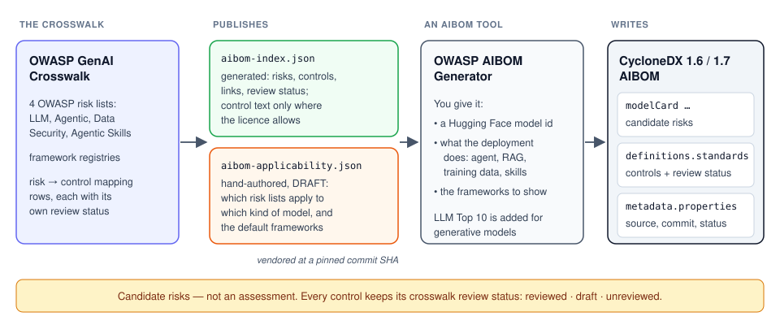
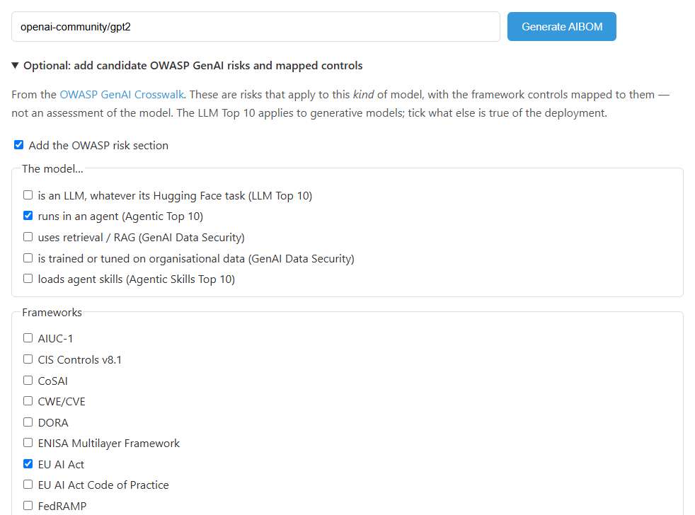
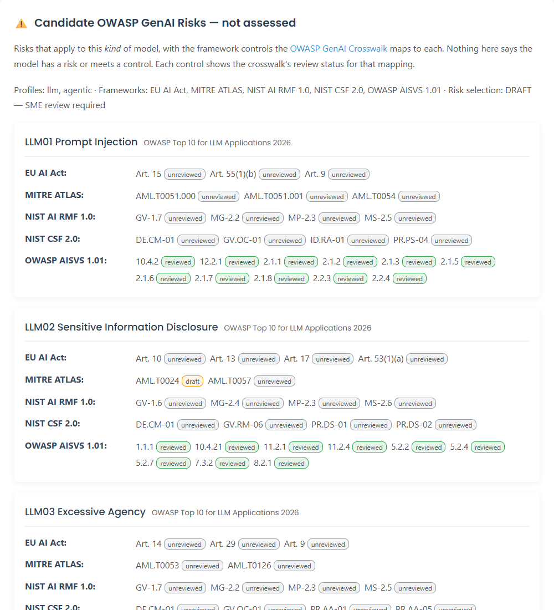

<!--
  OWASP GenAI Crosswalk
  File    : docs/AIBOM_INTEGRATION.md
  Purpose : How an AI Bill of Materials tool consumes the crosswalk (T-AIBOM01)
  Version : 1.1.0 — 2026-11-26
  License : CC BY-SA 4.0
-->

# Using the crosswalk in an AI Bill of Materials

An AI Bill of Materials (AIBOM) says what is inside a model. The crosswalk says
which OWASP GenAI risks a GenAI system faces and which framework controls are
mapped to each. This page is for tools that put the second into the first —
the first being the [OWASP AIBOM Generator](https://github.com/GenAI-Security-Project/aibom-generator).

Two files carry everything:

| File | What it is | Authored or generated |
|---|---|---|
| [`data/exports/aibom-index.json`](../data/exports/aibom-index.json) | Entries, framework registries, cited controls and every entry → control link | Generated by `scripts/export-aibom-index.js` |
| [`data/aibom-applicability.json`](../data/aibom-applicability.json) | Which source lists apply to which kind of model, and the default frameworks | Hand-authored, **DRAFT** |

Schemas: [`data/schemas/aibom-index.schema.json`](../data/schemas/aibom-index.schema.json) and
[`data/schemas/aibom-applicability.schema.json`](../data/schemas/aibom-applicability.schema.json).



## Quick start: the OWASP AIBOM Generator

Generator support is in review as
[aibom-generator #142](https://github.com/GenAI-Security-Project/aibom-generator/pull/142). Until it merges and
the hosted Space is redeployed, run it from that branch. It is off by default.

**In the web form**, open *Optional: add candidate OWASP GenAI risks and mapped controls*:

1. Tick **Add the OWASP risk section**. For a generative model this adds the LLM Top 10.
2. Tick what is true of the deployment: it runs in an agent, uses retrieval or organisational
   training data, or loads agent skills. Each one adds a whole list.
3. Pick frameworks, or keep the default verified core.



The result page gets a **Risks** tab: each candidate risk, its mapped controls per framework, and a
`reviewed` / `draft` / `unreviewed` badge on each control. The downloaded JSON carries the same content in
the places described under [CycloneDX placement](#cyclonedx-placement-as-used-by-the-owasp-aibom-generator).



**From the command line:**

```bash
python -m src.cli openai-community/gpt2 --owasp-risks
python -m src.cli openai-community/gpt2 --agentic --rag --training-data --skills \
  --frameworks "OWASP AISVS 1.01,NIST AI RMF 1.0,ISO/IEC 27001:2022"
```

`--llm` adds the LLM Top 10 whatever the model's task. `--frameworks` takes ids or names. An unknown
framework is an error, not a silent fallback.

**What to do with the result.** Treat the list as a starting point. Test the model and its deployment
against each candidate risk, and check the mapped controls you're responsible for. Weigh a `reviewed`
mapping above an `unreviewed` one. None of it is evidence that the model is safe or compliant.

## The one rule: candidate, not assessed

Nothing in these files says a model *has* a risk or *meets* a control. A tool
that reads them can say: *these are the OWASP GenAI risks that apply to this
kind of model, and these controls are mapped to them.* It must label the result
that way — "candidate risk — not assessed" — and it must not write it into a
field that asserts something about the model. In particular, do **not** fill
SPDX `safetyRiskAssessment` (a risk tier) or `standardCompliance` (standards
the model complies with) from this data.

## Picking the risks: `aibom-applicability.json`

A **profile** adds whole source lists, never single entries:

| Profile | Source list | When |
|---|---|---|
| `llm` | LLM Top 10 2026 (LLM01–LLM10) | By default, when the model's task is a generative task (`default_for_tasks`) |
| `agentic` | Agentic Top 10 2026 (ASI01–ASI10) | Only when the user says the model runs in an agent |
| `data` | GenAI Data Security 2026 (DSGAI01–DSGAI21) | Only when the user says it uses retrieval or organisational training data |
| `skills` | Agentic Skills Top 10 2026 (AST01–AST10) | Only when the user says it loads agent skills |

A model page alone cannot show how a model is deployed, so every profile but
`llm` is opt-in. The table is `DRAFT — SME review required` (security judgment,
C4); a tool should show that status.

`default_frameworks.framework_ids` is the verified core ratified in #99, MITRE
ATLAS included since its registry re-sync (#434). Show these when the user picks no
framework; let the user pick any framework in the index.

## Reading the links: `aibom-index.json`

```text
entries[]     { id, name, source_list, severity }
frameworks[]  { id, name, version, license, redistributable, url }
controls[]    { framework_id, control_id, url, title?, description? }
links[]       { entry, framework_id, control_id, relationship?, confidence,
                review_status, reviewed_by[] }
```

- **`review_status`** is what to show next to every control:
  - `reviewed` — the mapping row names a reviewer (`reviewed_by`).
  - `draft` — the row's notes carry the project's DRAFT marker.
  - `unreviewed` — neither. Most rows today.

  The counts are in `meta.counts.links_by_review_status`. Never present an
  `unreviewed` or `draft` link as reviewed.
- **`relationship`**, where present, is the control relative to the risk:
  `subset-of` means the control addresses part of the risk
  ([schema v2](SCHEMA_V2_MIGRATION.md)).
- **`redistributable: false`** frameworks (proprietary or non-commercial
  licences) have no `title` or `description` on their controls. Show the id and
  the link; do not fetch and embed the text.

## CycloneDX placement (as used by the OWASP AIBOM Generator)

- **`components[].modelCard.considerations.ethicalConsiderations[]`** — one
  `{name, mitigationStrategy}` per candidate risk: the entry as the name, and
  "Candidate risk — not assessed" followed by the mapped controls with their
  review status as the mitigation strategy.
- **`definitions.standards[]`** — one standard per selected source list (its
  entries as requirements) and one per selected framework (its linked controls
  as requirements, text only when redistributable), each with an external
  reference back to the crosswalk.
- **Properties** under `owasp:aibom:risk:*`:
  - `status`: `candidate-not-assessed`;
  - `source`: the crosswalk version and commit;
  - `profiles` and `frameworks`: what was applied;
  - `applicabilityStatus`: the status of the applicability table;
  - `linkReviewStatus`: counts of the selected links by review status;
  - `attribution`.

  Each control in `definitions.standards` also carries one
  `owasp:aibom:risk:link` property per mapping, as `<entry>|<relationship>|<review_status>`.
  `genai:aibom:*` is reserved for the official CycloneDX taxonomy.

## Pinning and attribution

- **Pin to a commit.** The index carries no date or commit, so its bytes depend
  only on the data. Vendor it from
  `https://raw.githubusercontent.com/GenAI-Security-Project/crosswalk/<commit-sha>/data/exports/aibom-index.json`
  (and the applicability file at the same SHA), and record the SHA in the BOM.
- **Attribution.** The data is CC BY-SA 4.0. Carry `meta.attribution` in the BOM
  or its tool notes, and keep derived data under the same licence.
- **Changes.** `meta.format_version` (and `format_version` in the applicability
  file) follows semantic versioning: a minor version adds fields, a major
  version changes or removes them. A consumer should refuse a major version it
  wasn't written for. The AIBOM Generator does this on load.

## Changelog

| Version | Date | Change |
|---|---|---|
| 1.0.0 | 2026-11-25 | Created with the index and applicability profiles (T-AIBOM01). |
| 1.1.0 | 2026-11-26 | Quick start for the OWASP AIBOM Generator with screenshots and a diagram. Full list of the `owasp:aibom:risk:*` properties; consumers should check the format major version. |
